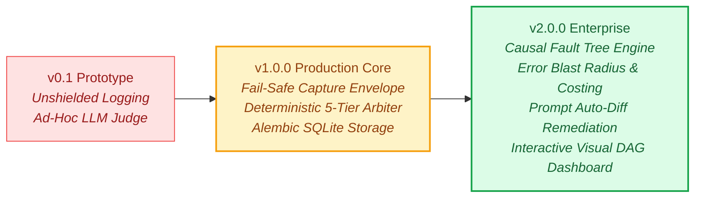
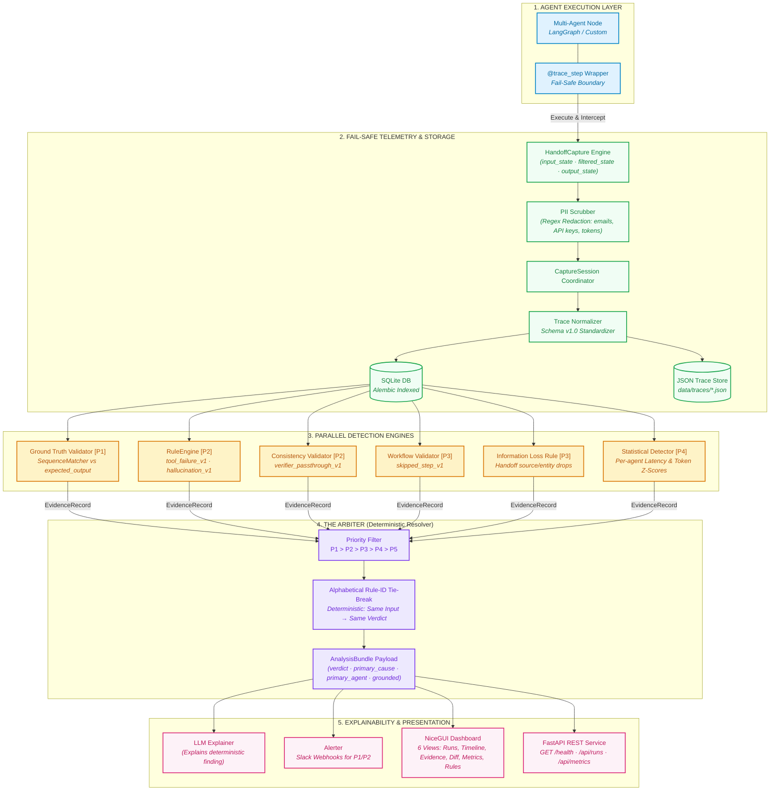

# AgentLens v2.0 Enterprise

[](https://github.com/Phoenixcoder-6/AgentLens/actions/workflows/ci.yml)
[](https://www.python.org/downloads/)
[](LICENSE)
[](https://github.com/Phoenixcoder-6/AgentLens)
[](CHANGELOG.md)

**Multi-Agent Causal Failure Attribution, Error Blast Radius, Trace Diffing & Automated Prompt Remediation**

AgentLens answers two critical questions with mathematical precision:  
1. *Why did a multi-agent workflow fail, and which agent was the true root cause vs. a downstream cascade?*  
2. *What did the failure cost (in wasted tokens, latency, and dollars), and what exact prompt patch will fix it?*

> **Core Philosophy:**  
> The LLM never decides what happened — it only explains what deterministic analysis has already proven.

---

## 1. Why AgentLens v2.0 Enterprise?

When complex LLM agent swarms fail (hallucinating facts, dropping instructions, crashing tools, or rubber-stamping bad output), debugging with standard logs or APMs is overwhelming:
- Traditional tracing tools (Datadog, OpenTelemetry) record *latencies* and *spans*, but understand nothing about *agent semantics*, *handoff contracts*, or *reasoning integrity*.
- LLM-as-a-judge approaches are probabilistic, non-deterministic, and frequently hallucinate their own blame attributions.

**AgentLens introduces Deterministic Multi-Tier Failure Attribution & Causal Remediation:**
1. **Causal Fault Tree Engine:** Maps error propagation across downstream spans, separating `ROOT_CAUSE_ORIGIN` from `CASCADING_FAILURE` and quality-control `PASSTHROUGH_ESCAPED` nodes.
2. **Error Blast Radius & Financial Waste Calculator:** Quantifies tainted steps ratio, downstream wasted tokens, wasted compute latency, and monetary USD loss.
3. **Automated Prompt Auto-Diff Engine:** Synthesizes targeted system prompt patches and GitHub-style unified diffs to remediate root causes without human guesswork.
4. **Interactive Visual DAG Dashboard:** Color-codes execution graphs in real time (🔴 Root Cause, 🟠 Cascade, 🟡 Passthrough, 🟢 Healthy) with one-click patch application.
5. **Drop-in Framework Auto-Tracers:** Seamless zero-code hooks for LangGraph, CrewAI, AutoGen, and LangChain.
6. **Deterministic 5-Tier Arbiter:** Guarantees that the exact same evidence always yields the exact same verdict ($P_1 \to P_5$).

---

### 2. Architecture: Evolution to v2.0 Enterprise

AgentLens evolved through three major generational milestones:



---

### Phase 2: Current Production Architecture (v1.0.0 Enterprise Core)
v1.0.0 introduces a fail-safe capture envelope, canonical normalization, 6 multi-tier detection analyzers, the deterministic 5-tier Arbiter ($P_1 \to P_5$), and dual presentation interfaces (NiceGUI + FastAPI):



---

### Architectural Comparison: Prototype vs. v1.0.0 Production

| Dimension | Legacy Prototype (v0.1) | AgentLens v1.0.0 Production |
|---|---|---|
| **Pipeline Safety** | Unhandled logging crashes pipeline | **Fail-Safe Envelope**: telemetry errors are trapped; pipeline never fails |
| **Privacy & Security** | Plaintext state dump to disk | **PII Scrubber**: automated redaction of emails, API keys, bearer tokens |
| **Attribution Logic** | LLM-as-a-judge probabilistic guesswork | **Deterministic Arbiter**: strict 5-tier priority ladder with rule-id tie-breaking |
| **Co-occurrence Handling**| Conflicting rules produce chaotic alerts | **Upstream Root-Cause Prioritization**: upstream errors take precedence |
| **Ground Truth Support** | None (pure heuristic) | **Explicit Grounded Boundary**: $P_1$ factual contracts vs. $P_2–P_4$ structural heuristics |
| **Storage Engine** | Flat unstructured JSON files | **Indexed SQLite + Alembic Migrations**: 5 performance indexes & schema versioning |
| **Delivery Interfaces** | Terminal CLI script only | **NiceGUI Interactive Dashboard (6 Views) + FastAPI REST API + Docker** |

---

## 3. Quickstart (Zero-Setup in 3 Commands)

### Option A: Local Python Package Installation

```bash
# 1. Install editable package
pip install -e .

# 2. Seed pre-computed zero-setup demo traces (PASS, Grounded P1, Heuristic P2/P3, Diff Pairs)
agentlens-seed

# 3. Launch the AgentLens interactive dashboard
agentlens-dashboard
```
Open **`http://localhost:8080`** in your browser.

---

### Option B: One-Command Docker Setup

```bash
docker compose up --build
```
The NiceGUI dashboard and FastAPI REST endpoints are exposed at **`http://localhost:8080`**.  
Liveness/readiness is monitored via `GET http://localhost:8080/health`.

---

## 4. Benchmark Accuracy & Regression Gates

AgentLens is continuously certified against both the frozen 20-trace baseline benchmark (`sample_data/labels.json`) and the extended 30-trace enterprise regression suite (`scripts/run_v2_regression.py`):

| Evaluation Gate | Metric | Target | Verified Actual | Status |
|---|---|---|---|---|
| **v2.0 Extended 30-Trace Suite** | **Exact Attribution Accuracy** | $\ge 85.0\%$ | **86.7%** (26/30) | **PASS** |
| **v2.0 Extended 30-Trace Suite** | **Binary Failure Detection** | $100.0\%$ | **100.0%** (30/30) | **PASS** |
| **Day 43 Frozen Baseline** | **Attribution Preservation** | $\ge 80.0\%$ | **80.0%** (16/20, 0 regressions) | **PASS** |
| **Full Unit & Integration Suite** | **Test Pass Rate** | $100.0\%$ | **210 / 210 passing** | **PASS** |
| **Test Coverage Gate** | **Code Coverage (`--cov`)** | $\ge 80.0\%$ | **94.0%** (v2 core modules) | **PASS** |
| **Type Checking (`mypy`)** | **Strict PEP 561** | Clean | **0 issues** across all files | **PASS** |
| **Code Formatting & Lint (`ruff`)** | **Zero Defects** | Clean | **0 issues** | **PASS** |

Continuous regression testing is enforced on every PR to `main` via [`.github/workflows/ci.yml`](.github/workflows/ci.yml).

---

## 5. Python SDK & CLI Quickstart

### Python SDK
```python
import agentlens

# 1. Run causal fault tree analysis on a trace
graph = agentlens.CausalGraphEngine().build_graph(run_trace)
print(f"Root Cause Agent: {graph.nodes[graph.root_causes[0]].name}")
print(f"Cascading Failures: {len(graph.cascades)}")
print(f"Passthrough Escapes: {len(graph.passthroughs)}")

# 2. Compute error blast radius & dollar waste
blast_radius = agentlens.BlastRadiusCalculator().calculate(run_trace, causal_graph=graph)
print(f"Wasted Cost: ${blast_radius.wasted_cost_usd:.4f}")
print(f"Wasted Tokens: {blast_radius.wasted_tokens}")

# 3. Generate automated prompt remediation patch & diff
patch = agentlens.PromptFixer().generate_patch(run_trace, analysis_bundle=bundle)
if patch:
    print(patch.unified_diff)
```

### CLI
```bash
# Run causal attribution analysis
agentlens causal run_failed_01

# Calculate financial blast radius
agentlens blast-radius run_failed_01

# Generate recommended prompt fix diff
agentlens patch run_failed_01

# Launch visual DAG dashboard
agentlens-dashboard
```

---

## 6. REST API

AgentLens includes a built-in FastAPI REST service mounted at `/api` and `/health`:

| Method | Endpoint | Description |
|---|---|---|
| `GET` | `/health` | Liveness & readiness check (`status`, `db`, `llm`, `uptime_seconds`) |
| `GET` | `/api/runs` | List recorded runs with pagination & verdict level filters |
| `GET` | `/api/runs/{run_id}` | Full trace details including per-agent steps & state diffs |
| `GET` | `/api/runs/{run_id}/verdict` | Final Arbiter verdict bundle & primary cause |
| `POST` | `/api/analyze/{run_id}` | Trigger deterministic analysis on an existing trace |
| `GET` | `/api/metrics` | Aggregated latency, token, and run counts per agent |

Interactive Swagger documentation is available at `http://localhost:8080/docs`.

---

## 7. Project Documentation Index

- **[ARCHITECTURE.md](ARCHITECTURE.md)**: Deep dive into the v2.0 Causal Engine, Blast Radius Calculator, Prompt Auto-Diff, Arbiter, and Pluggable Storage.
- **[docs/ARCHITECTURE_V2.md](docs/ARCHITECTURE_V2.md)**: Multi-phase v2.0 roadmap, specifications, and architecture decisions.
- **[RULES.md](RULES.md)**: Exhaustive catalog of built-in deterministic detection rules (P1–P4).
- **[LIMITATIONS.md](LIMITATIONS.md)**: Benchmark error analysis, scope boundaries, and dual-fault tie-break dynamics.
- **[CONTRIBUTING.md](CONTRIBUTING.md)**: Developer setup, test guidelines, pre-commit hooks, and PR workflow.
- **[CHANGELOG.md](CHANGELOG.md)**: Complete release history from v0.1.0 to v2.0.0.

---

## 8. License

AgentLens is open-source software licensed under the [MIT License](LICENSE).
