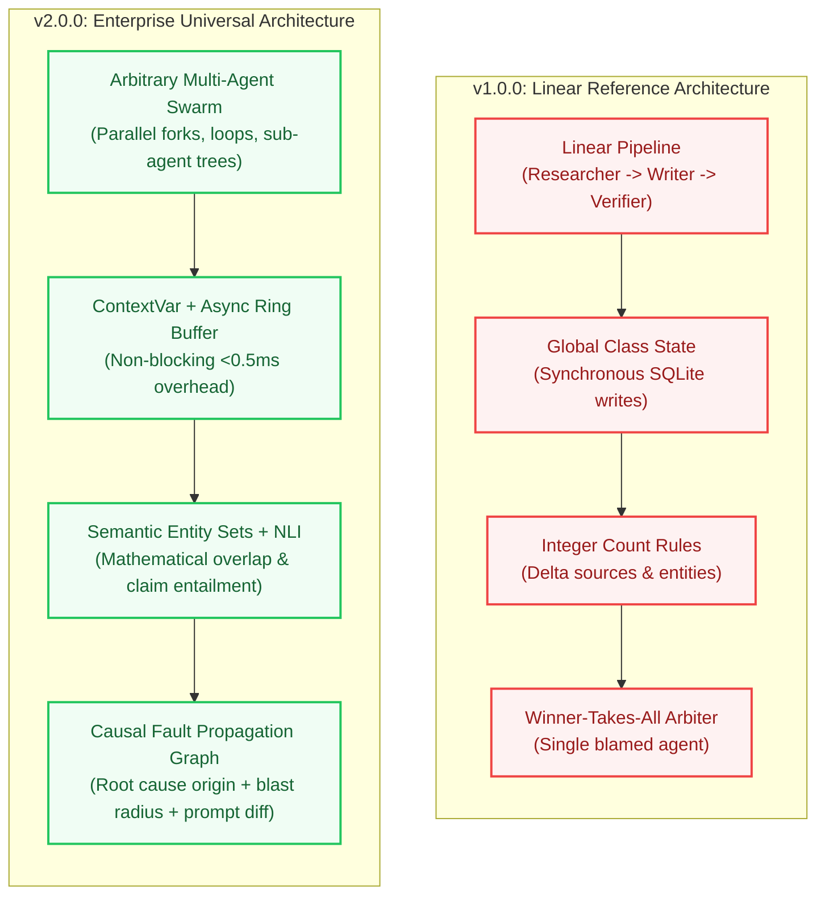

# AgentLens v2.0 Architecture & Strategic Implementation Plan

> **Official Roadmap:** This document outlines the technical design, architectural evolution, and multi-phase implementation plan for **AgentLens v2.0 Enterprise**.  
> For the complete 4-task/day breakdown, refer to [day_wise_plan_v2.md](day_wise_plan_v2.md). For the high-level roadmap, see [project_plan_v2.md](project_plan_v2.md).

---

## 1. Executive Summary

AgentLens **v1.0.0** successfully established a deterministic failure attribution engine ($P_1 \to P_5$), fail-safe telemetry capture, graph-aligned cross-run trace diffing, and zero regressions on the 20-trace benchmark (80% exact attribution, 100% binary accuracy).

**AgentLens v2.0** scales this foundation into a **universal, enterprise-grade multi-agent observability platform** capable of monitoring arbitrary $N$-agent swarms, parallel execution forks, reflection cycles, and hierarchical teams across LangGraph, CrewAI, AutoGen, and raw OpenTelemetry frameworks.

---

## 2. Four Strategic Pillars of v2.0

```
┌────────────────────────────────────────────────────────────────────────┐
│ PHASE A: STABILIZATION (Concurrency, Thread Isolation, Async Ingestion)│
├────────────────────────────────────────────────────────────────────────┤
│ PHASE B: UNIVERSAL CORE (DAG Topology, Span Trees, Semantic NLI Engine)│
├────────────────────────────────────────────────────────────────────────┤
│ PHASE C: DEVELOPER EXPERIENCE (Universal Drop-in SDK, Auto-Tracing)    │
├────────────────────────────────────────────────────────────────────────┤
│ PHASE D: INTELLIGENCE & REMEDIATION (Causal Fault Graphs, Prompt Diffs)│
└────────────────────────────────────────────────────────────────────────┘
```

### Phase A: Stabilization & Concurrency (Days 47–51)
- **Thread & Task Isolation:** Eradicate global singleton class variables; migrate `CaptureSession` to Python `contextvars.ContextVar` for thread-safe concurrent pipeline execution.
- **Non-Blocking Telemetry Ingestion:** Introduce an in-memory bounded ring buffer with a background daemon worker to ensure telemetry interception never adds $>0.5\text{ms}$ to pipeline execution.
- **High-Concurrency Storage:** Configure SQLite WAL mode (Write-Ahead Logging) and connection pooling; abstract storage adapters for PostgreSQL / ClickHouse.

### Phase B: Universal Core & Semantic Logic (Days 52–56)
- **OpenInference Span DAG Schema:** Replace 1D flat step arrays with hierarchical DAG span trees (`TraceSpan` with `parent_span_id`, `span_type`, and `iteration_index`), natively supporting parallel forks, sub-agent call trees, and reflection loops.
- **Semantic Entity Set Tracking:** Replace naive integer counting with mathematical set difference analysis ($E_{\text{downstream}} \setminus E_{\text{upstream}}$), catching entity replacement hallucinations.
- **Local NLI Cross-Encoder Verification:** Integrate a quantized DeBERTa cross-encoder scoring claim entailment vs. contradiction directly on agent handoffs.

### Phase C: Developer Experience & Auto-Instrumentation (Days 57–61)
- **3-Line Drop-in SDK:** Expose a unified public interface:
  ```python
  import agentlens

  agentlens.init(project="my-swarm")
  ```
- **Framework Auto-Tracers:** Out-of-the-box callback handlers for LangGraph, CrewAI, and AutoGen.
- **OpenTelemetry OTLP Ingestion:** `POST /v1/traces` endpoint accepting standard OTel Protobuf/JSON spans with zero code changes required.

### Phase D: Causal Attribution & Remediation (Days 62–66)
- **Causal Fault Propagation Trees:** Move beyond single-agent blame masking to full causal blast radius mapping (`Root Cause Origin` $\to$ `Cascading Failure` $\to$ `Passthrough Escaped`).
- **Automated Prompt Self-Healing:** Generate git-diff prompt recommendations comparing failed agent instructions against clean historical baselines.
- **Interactive Visual DAG Dashboard:** Color-coded graph visualization of agent swarms rendered directly in NiceGUI.

---

## 3. High-Level Architecture Comparison



---

## 4. Verification & Quality Gates

All v2.0 development strictly preserves existing guarantees:
1. **100% Backward Compatibility:** All 20 frozen benchmark traces (`sample_data/labels.json`) must continue to pass with $\ge 80\%$ exact attribution.
2. **Coverage Gate:** Test coverage maintained at $\ge 75\%$ throughout Phases A–C, scaling to $\ge 80\%$ in Phase D.
3. **Type Safety:** Strict PEP 561 compliance with `mypy --strict` on all new modules.

For the detailed day-by-day implementation breakdown, see [project_plan_v2.md](project_plan_v2.md).
